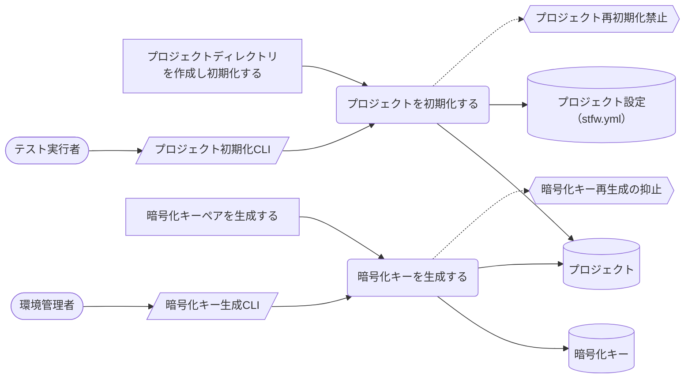
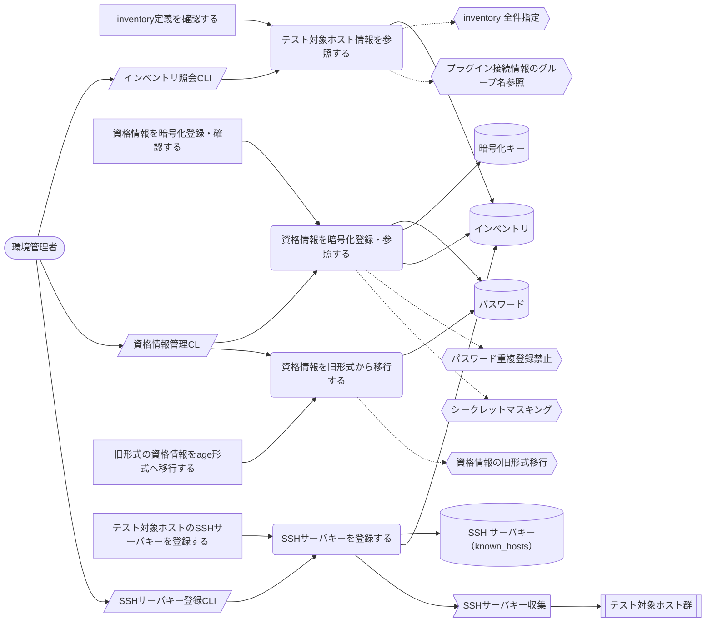
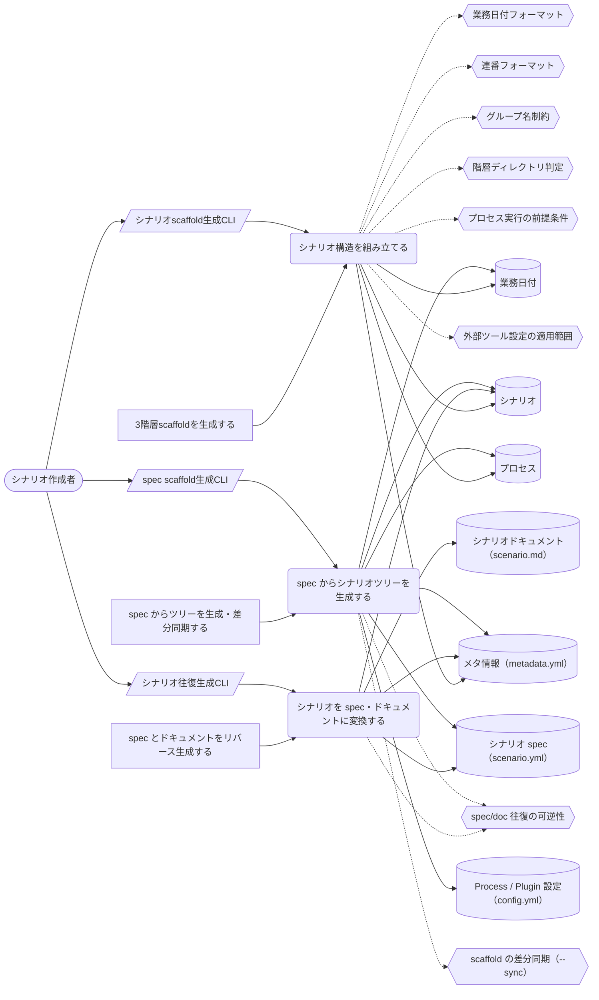
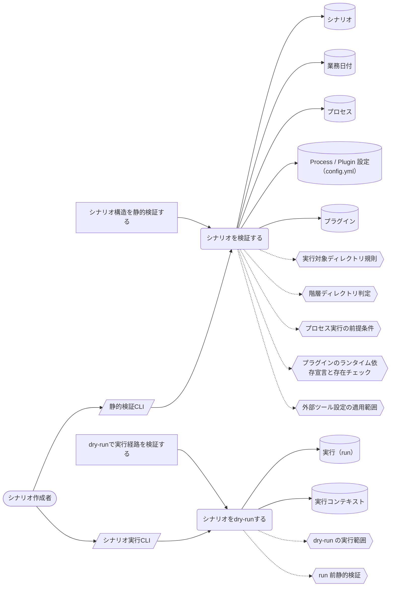
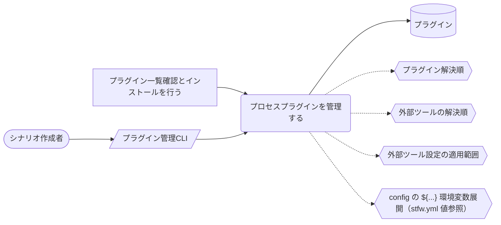
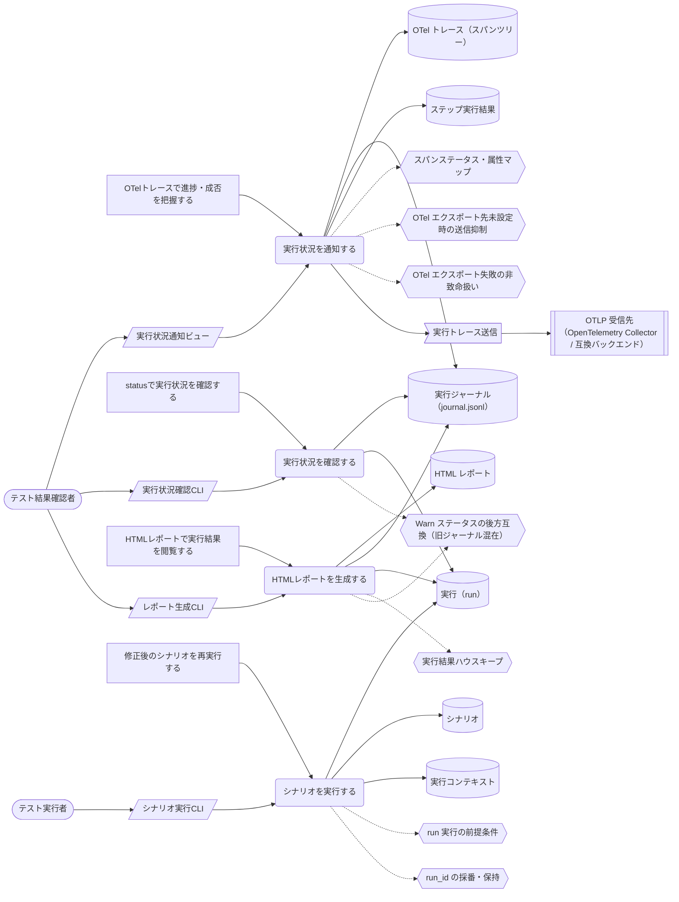

<!-- generateRdraMd.js による自動生成ファイル。手動編集しないこと。元データ: docs/rdra/latest/*.tsv -->

# UC複合図

RDRA システム境界レイヤー。BUC ごとに、アクティビティ・UC・画面・イベント・
情報・条件・外部システムの関係を表す。

## テスト環境準備業務

### プロジェクト初期化フロー

> 凡例: `(丸角)` アクター・UC / `[四角]` アクティビティ / `[/斜め/]` 画面 / `[(円柱)]` 情報 / `{{六角}}` 条件 / `>旗]` イベント / `[[二重枠]]` 外部システム。点線は条件参照。

| UC | アクティビティ | 画面 | 情報 | 条件 | イベント | 説明 |
|---|---|---|---|---|---|---|
| プロジェクトを初期化する | プロジェクトディレクトリを作成し初期化する | プロジェクト初期化CLI | プロジェクト、プロジェクト設定（stfw.yml） | プロジェクト再初期化禁止 |  | stfw initでテンプレート一式（stfw.yml・config・sampleシナリオ）をプロジェクトディレクトリへ展開してプロジェクトを開始する（再初期化は禁止） |
| 暗号化キーを生成する | 暗号化キーペアを生成する | 暗号化キー生成CLI | 暗号化キー、プロジェクト | 暗号化キー再生成の抑止 |  | stfw secret keygenで資格情報暗号化用のage (X25519)キーペアを生成し、資格情報を平文で扱わない準備を整える（再生成は--force指定時のみ） |

### 接続情報管理フロー

> 凡例: `(丸角)` アクター・UC / `[四角]` アクティビティ / `[/斜め/]` 画面 / `[(円柱)]` 情報 / `{{六角}}` 条件 / `>旗]` イベント / `[[二重枠]]` 外部システム。点線は条件参照。

| UC | アクティビティ | 画面 | 情報 | 条件 | イベント | 説明 |
|---|---|---|---|---|---|---|
| テスト対象ホスト情報を参照する | inventory定義を確認する | インベントリ照会CLI | インベントリ | inventory 全件指定、プラグイン接続情報のグループ名参照 |  | stfw inventory existsでホストグループの存在確認、stfw inventory listでホスト一覧取得を行い、定義内容を検証する（旧 --is-exist / --list と出力互換） |
| 資格情報を暗号化登録・参照する | 資格情報を暗号化登録・確認する | 資格情報管理CLI | パスワード、暗号化キー、インベントリ | パスワード重複登録禁止、シークレットマスキング |  | stfw secret setでホスト×ユーザー単位の資格情報をage (X25519)で暗号化保管し、stfw secret showで復号表示して登録内容を確認する（重複登録は禁止）。組み込みプラグインの収集先・接続先への接続資格情報も本機構で参照される |
| 資格情報を旧形式から移行する | 旧形式の資格情報をage形式へ移行する | 資格情報管理CLI | パスワード | 資格情報の旧形式移行 |  | stfw secret migrateで旧S/MIME形式の資格情報をage形式へ一括変換する（旧ファイルは.bak退避）。移行前も旧形式は読み込み専用でサポートされ復号参照できる |
| SSHサーバキーを登録する | テスト対象ホストのSSHサーバキーを登録する | SSHサーバキー登録CLI | SSH サーバキー（known_hosts）、インベントリ |  | SSHサーバキー収集 | stfw ssh trust <host\|group>でテスト対象ホストのサーバキーをknown_hostsへ登録する（旧キー削除+新キー登録）。inventoryグループ指定で一括登録できる（旧実装で未配線だった機能の正式コマンド化）。組み込みプラグイン（collectLog / collectFile）のscp/ssh接続でも本登録が利用される |

## シナリオ作成業務

### テストシナリオ作成フロー

> 凡例: `(丸角)` アクター・UC / `[四角]` アクティビティ / `[/斜め/]` 画面 / `[(円柱)]` 情報 / `{{六角}}` 条件 / `>旗]` イベント / `[[二重枠]]` 外部システム。点線は条件参照。

| UC | アクティビティ | 画面 | 情報 | 条件 | イベント | 説明 |
|---|---|---|---|---|---|---|
| シナリオ構造を組み立てる | 3階層scaffoldを生成する | シナリオscaffold生成CLI | シナリオ、業務日付、プロセス、メタ情報（metadata.yml） | 業務日付フォーマット、連番フォーマット、グループ名制約、階層ディレクトリ判定、プロセス実行の前提条件、外部ツール設定の適用範囲 |  | stfw new scenario / new bizdate / new processでscenario > bizdate > processの3階層scaffold（ディレクトリ・metadata.yml・config・scripts雛形）を生成し、テストシナリオの骨格を作る（旧 scenario -i / bizdate -i / process -i）。stfw new process で template/ が無く既定 config.yml を複製するときは、plugin.yml の provision_keys の宣言キーを除く |
| シナリオを spec・ドキュメントに変換する | spec とドキュメントをリバース生成する | シナリオ往復生成CLI | シナリオ spec（scenario.yml）、シナリオドキュメント（scenario.md）、メタ情報（metadata.yml）、シナリオ | spec/doc 往復の可逆性 |  | stfw scenario reverse <name> [-o, --out-dir <dir>] でシナリオツリー（規約ベースの記述＝正）から spec（<name>.yml）とドキュメント（<name>.md）をセット生成する（既定の出力先は docs/）。ドキュメントには各プロセスの group / type / description・要求トレーサビリティ（metadata.yml の requirement_specifications = どの要求をどの process が検証するか）・config サブツリーを表形式で出力する |
| spec からシナリオツリーを生成する | spec からツリーを生成・差分同期する | spec scaffold生成CLI | シナリオ spec（scenario.yml）、シナリオ、業務日付、プロセス、メタ情報（metadata.yml）、Process / Plugin 設定（config.yml） | scaffold の差分同期（--sync）、spec/doc 往復の可逆性 |  | stfw scaffold <spec.yml> [--sync] で spec からディレクトリ骨格（scenario > bizdate > process のディレクトリ・metadata.yml・config）を生成する。既存ツリーがある場合 --sync は差分同期（spec に有りツリーに無いディレクトリは追加、両方に有るディレクトリは維持、spec に無くなったディレクトリは削除）、--sync 無しはエラー終了。対話的 scaffold 生成（stfw new）とは別に spec ファイルを単一ソースとしたツリー生成・差分同期の入口を提供する |

### シナリオ静的検証フロー

> 凡例: `(丸角)` アクター・UC / `[四角]` アクティビティ / `[/斜め/]` 画面 / `[(円柱)]` 情報 / `{{六角}}` 条件 / `>旗]` イベント / `[[二重枠]]` 外部システム。点線は条件参照。

| UC | アクティビティ | 画面 | 情報 | 条件 | イベント | 説明 |
|---|---|---|---|---|---|---|
| シナリオを検証する | シナリオ構造を静的検証する | 静的検証CLI | シナリオ、業務日付、プロセス、Process / Plugin 設定（config.yml）、プラグイン | 実行対象ディレクトリ規則、階層ディレクトリ判定、プロセス実行の前提条件、プラグインのランタイム依存宣言と存在チェック、外部ツール設定の適用範囲 |  | stfw validateでディレクトリ規約・プラグイン解決可否・config.yml・プラグインが宣言したランタイム依存（前提コマンド: mysql/psqlクライアント・ssh/scp等）を静的検証し、実行可能性を事前確認する。残存する*.digファイルには不要である旨を警告する（ワークフロー定義の生成は廃止され、記述したディレクトリ構造そのものが実行定義となる）。プロセスの config/config.yml に provision_keys の宣言キーが残っていれば、プロジェクト共通の設定先を示して警告する（警告のみなら exit 0） |
| シナリオをdry-runする | dry-runで実行経路を検証する | シナリオ実行CLI | 実行（run）、実行コンテキスト | dry-run の実行範囲、run 前静的検証 |  | stfw run --dry-runでexecute / post_executeをスキップして実行し（setup → pre_execute → teardownは実行）、テスト対象環境への影響なしに実行経路と前後処理を事前検証する |

### プロセスプラグイン拡張フロー

> 凡例: `(丸角)` アクター・UC / `[四角]` アクティビティ / `[/斜め/]` 画面 / `[(円柱)]` 情報 / `{{六角}}` 条件 / `>旗]` イベント / `[[二重枠]]` 外部システム。点線は条件参照。

| UC | アクティビティ | 画面 | 情報 | 条件 | イベント | 説明 |
|---|---|---|---|---|---|---|
| プロセスプラグインを管理する | プラグイン一覧確認とインストールを行う | プラグイン管理CLI | プラグイン | プラグイン解決順、外部ツールの解決順、外部ツール設定の適用範囲、config の ${...} 環境変数展開（stfw.yml 値参照） |  | stfw plugin listで利用可能なプロセスプラグイン（組込みプラグイン群: scripts・収集系 collectLog / collectFile・データストア系 exportXxx / importXxx / clearXxx・検証系 compare / compareRegex・実行系 invokeWeb / invokeRest、およびプロジェクトのカスタムプラグイン）を一覧し、stfw plugin installでプラグインをインストールする（旧 process -l / -I。解決順互換。scaffold生成はstfw new processで行う）。外部ツールは永続キャッシュ → 版一致の同梱版 → 未プロビジョニングの順で判定し、同梱版で配備済みなら stfw plugin install は exit 3、stfw init はダウンロードを省略する。stfw plugin install は stfw.yml（+ 同梱デフォルト）を環境へ反映してからプラグイン設定を読み、外部ツールの宣言キーに実行時と同じプロジェクト共通までの値を使う |

## シナリオ実行業務

### シナリオ一括自動実行フロー

```mermaid
graph LR
  UC1("シナリオを実行する")
  AT1["実行対象シナリオを指定して一括実行を開始する"]
  IF1[("実行（run）")]
  IF2[("シナリオ")]
  IF3[("実行コンテキスト")]
  CD1{{"run 実行の前提条件"}}
  CD2{{"run 前静的検証"}}
  CD3{{"run_id の採番・保持"}}
  SC1[/"シナリオ実行CLI"/]
  AC1(["テスト実行者"])
  CD4{{"実行結果ハウスキープ"}}
  IF4[("実行ジャーナル（journal.jsonl）")]
  IF5[("HTML レポート")]
  IF6[("プロジェクト設定（stfw.yml）")]
  UC2("階層setup/teardownを実行する")
  AT2["内蔵ランナーが各階層のsetup/teardownを実行する"]
  IF7[("実行ログ")]
  CD5{{"設定の上書き順"}}
  UC3("プロセスを実行する")
  AT3["内蔵ランナーがプロセスをプラグインで実行する"]
  IF8[("プロセス")]
  IF9[("スクリプト（ステップ）")]
  IF10[("ステップ実行結果")]
  IF11[("Process / Plugin 設定（config.yml）")]
  IF12[("プラグイン")]
  IF13[("エビデンス")]
  IF14[("期待値（expect）")]
  IF15[("比較結果")]
  IF16[("インベントリ")]
  IF17[("パスワード")]
  IF18[("SSH サーバキー（known_hosts）")]
  CD6{{"逐次実行・エラー時 Blocked"}}
  CD7{{"dry-run の実行範囲"}}
  CD8{{"プロセス実行の前提条件"}}
  CD9{{"プラグイン解決順"}}
  CD10{{"階層ディレクトリ判定"}}
  CD11{{"収集先ホストとの時刻同期前提"}}
  CD12{{"export/import ラウンドトリップ互換"}}
  CD13{{"エビデンスディレクトリ規約"}}
  CD14{{"比較不一致はステップ失敗"}}
  CD15{{"プラグイン接続情報のグループ名参照"}}
  EV1>"リモートテスト適用"]
  EX1[["テスト対象ホスト群"]]
  EV2>"ログ・ファイル収集（scp/ssh）"]
  EV3>"ログフィルタ転送・実行"]
  EX2[["logfilter（ログ収集 OSS）"]]
  EV4>"k6テスト実行"]
  EX3[["grafana k6"]]
  EV5>"テスト対象データストア接続"]
  EX4[["テスト対象データストア（MySQL / PostgreSQL / Redis）"]]
  EV6>"ファイル比較実行"]
  EX5[["compare-files（ファイル比較 OSS）"]]
  CD16{{"sshExec のリモートスクリプト一括実行"}}
  CD17{{"scpPut の原子的配置"}}
  CD18{{"プラグインのランタイム依存宣言と存在チェック"}}
  EV7>"リモートスクリプト一括実行（ssh）"]
  EV8>"ローカルファイル原子的配置（scp）"]
  CD19{{"invoke エビデンス HTML レポート生成の優先順"}}
  CD20{{"config の ${...} 環境変数展開（stfw.yml 値参照）"}}
  CD21{{"run 終了コードの集約（0/3/6）"}}
  CD22{{"実行ステータス集約（Error > Warn > Success）"}}
  CD23{{"部分実行の指定制約"}}
  CD24{{"部分実行のスキップ意味論"}}
  CD25{{"parallel 子プロセスの並走実行"}}
  IF19[("比較対象設定（compare_target.csv）")]
  CD26{{"compareRegex 比較の素通り防止"}}
  IF20[("実行ワークスペース")]
  CD27{{"実行ワークスペースの複製"}}
  CD28{{"resume の引き継ぎ元とマージ"}}
  CD29{{"resume 時の compareRegex 比較対象の入れ替え"}}
  CD30{{"外部ツールの解決順"}}
  CD31{{"compareRegex の比較ルール解決"}}
  CD32{{"collectLog のログ形式設定の事前検証"}}
  CD33{{"collectLog の該当ログ 0 件時の扱い"}}
  CD34{{"外部ツール設定の適用範囲"}}
  AT1 --> UC1
  UC1 --> IF1
  UC1 --> IF2
  UC1 --> IF3
  UC1 -.-> CD1
  UC1 -.-> CD2
  UC1 -.-> CD3
  AC1 --> SC1
  SC1 --> UC1
  UC1 -.-> CD4
  UC1 --> IF4
  UC1 --> IF5
  UC1 --> IF6
  AT2 --> UC2
  UC2 --> IF3
  UC2 --> IF4
  UC2 --> IF7
  UC2 -.-> CD5
  SC1 --> UC2
  AT3 --> UC3
  UC3 --> IF8
  UC3 --> IF9
  UC3 --> IF10
  UC3 --> IF11
  UC3 --> IF4
  UC3 --> IF12
  UC3 --> IF13
  UC3 --> IF14
  UC3 --> IF15
  UC3 --> IF16
  UC3 --> IF17
  UC3 --> IF18
  UC3 -.-> CD6
  UC3 -.-> CD7
  UC3 -.-> CD8
  UC3 -.-> CD5
  UC3 -.-> CD9
  UC3 -.-> CD10
  UC3 -.-> CD11
  UC3 -.-> CD12
  UC3 -.-> CD13
  UC3 -.-> CD14
  UC3 -.-> CD15
  SC1 --> UC3
  UC3 --> EV1
  EV1 --> EX1
  UC3 --> EV2
  EV2 --> EX1
  UC3 --> EV3
  EV3 --> EX2
  UC3 --> EV4
  EV4 --> EX3
  UC3 --> EV5
  EV5 --> EX4
  UC3 --> EV6
  EV6 --> EX5
  UC3 -.-> CD16
  UC3 -.-> CD17
  UC3 -.-> CD18
  UC3 --> EV7
  EV7 --> EX1
  UC3 --> EV8
  EV8 --> EX1
  UC3 -.-> CD19
  UC3 -.-> CD20
  UC1 -.-> CD21
  UC2 -.-> CD22
  UC3 -.-> CD22
  UC1 -.-> CD23
  UC2 -.-> CD24
  UC3 -.-> CD24
  UC3 -.-> CD25
  UC3 --> IF19
  UC3 -.-> CD26
  UC1 --> IF20
  UC1 -.-> CD27
  UC1 -.-> CD28
  UC3 -.-> CD29
  UC3 -.-> CD30
  UC3 -.-> CD31
  UC3 -.-> CD32
  UC3 -.-> CD33
  UC3 -.-> CD34
```

> 凡例: `(丸角)` アクター・UC / `[四角]` アクティビティ / `[/斜め/]` 画面 / `[(円柱)]` 情報 / `{{六角}}` 条件 / `>旗]` イベント / `[[二重枠]]` 外部システム。点線は条件参照。

| UC | アクティビティ | 画面 | 情報 | 条件 | イベント | 説明 |
|---|---|---|---|---|---|---|
| シナリオを実行する | 実行対象シナリオを指定して一括実行を開始する | シナリオ実行CLI | 実行（run）、シナリオ、実行コンテキスト、実行ジャーナル（journal.jsonl）、HTML レポート、プロジェクト設定（stfw.yml）、実行ワークスペース | run 実行の前提条件、run 前静的検証、run_id の採番・保持、実行結果ハウスキープ、run 終了コードの集約（0/3/6）、部分実行の指定制約、実行ワークスペースの複製、resume の引き継ぎ元とマージ |  | stfw run は静的検証を通過後、stfw.housekeep.retention_days に従って期限切れの run ディレクトリ（ジャーナル・実行ワークスペース・生成物）と HTML レポートを削除する。--resume 指定時は引き継ぎ元を検証し、run_id 採番・ジャーナル作成後は正本を複製し、--resume 指定時は引き継ぎ元から生成物などを取り込む。stdout に run_id:、workspace:、resume 時は resume_from: の順で出力する。部分実行の --from / --only は実行対象を絞り込み、--resume は過去 run の生成物を引き継ぐ。部分実行ではシナリオを 1 つ指定する。--from と --only は排他で、--dry-run と併用できる。指定ノードが存在しない場合はハウスキープ・採番・ジャーナル作成前にエラー終了し、run 前静的検証はフィルタ前のシナリオ全体に実施する。 |
| 階層setup/teardownを実行する | 内蔵ランナーが各階層のsetup/teardownを実行する | シナリオ実行CLI | 実行コンテキスト、実行ジャーナル（journal.jsonl）、実行ログ | 設定の上書き順、実行ステータス集約（Error > Warn > Success）、部分実行のスキップ意味論 |  | 内蔵ランナーがrun/scenario/bizdate各階層のsetup/teardownを直接実行し（digdagからの呼び戻しは廃止）、実行ジャーナルへ開始・終了イベントを記録して階層実行ステータスをStarted→Success/Warn/Errorへ遷移させる。上位階層の実行ステータスは配下のError > Warn > Successの優先度で集約され、子にWarnがあれば親もWarnになる。run階層のteardownフックへ公開される環境変数stfw_run_statusは、Warnあり・ErrorなしのrunでWarnになる。bizdateのnode_startイベント時刻はプラグインenv契約（stfw_bizdate_start_ts等）として後続のプロセス実行へ公開される。部分実行（--from / --only）では、スキップされたノードのイベント（node_start / node_end・フック）は実行ジャーナルへ一切記録されず、実行されるノードの祖先階層のフック（run / scenario / 実行対象を含むbizdateのsetup・teardown）は通常どおり実行される。runのnode_startのattrsには部分実行時のみfrom / only（指定パス）が記録される。階層フックはプロジェクト側で動作し、各階層のディレクトリ env は実行ワークスペースを指す。resume 時の run の node_start には resume_from も記録する |
| プロセスを実行する | 内蔵ランナーがプロセスをプラグインで実行する | シナリオ実行CLI | プロセス、スクリプト（ステップ）、ステップ実行結果、Process / Plugin 設定（config.yml）、実行ジャーナル（journal.jsonl）、プラグイン、エビデンス、期待値（expect）、比較結果、インベントリ、パスワード、SSH サーバキー（known_hosts）、比較対象設定（compare_target.csv） | 逐次実行・エラー時 Blocked、dry-run の実行範囲、プロセス実行の前提条件、設定の上書き順、プラグイン解決順、階層ディレクトリ判定、収集先ホストとの時刻同期前提、export/import ラウンドトリップ互換、エビデンスディレクトリ規約、比較不一致はステップ失敗、プラグイン接続情報のグループ名参照、sshExec のリモートスクリプト一括実行、scpPut の原子的配置、プラグインのランタイム依存宣言と存在チェック、invoke エビデンス HTML レポート生成の優先順、config の ${...} 環境変数展開（stfw.yml 値参照）、実行ステータス集約（Error > Warn > Success）、部分実行のスキップ意味論、parallel 子プロセスの並走実行、compareRegex 比較の素通り防止、resume 時の compareRegex 比較対象の入れ替え、外部ツールの解決順、compareRegex の比較ルール解決、collectLog のログ形式設定の事前検証、collectLog の該当ログ 0 件時の扱い、外部ツール設定の適用範囲 | リモートテスト適用、ログ・ファイル収集（scp/ssh）、ログフィルタ転送・実行、k6テスト実行、テスト対象データストア接続、ファイル比較実行、リモートスクリプト一括実行（ssh）、ローカルファイル原子的配置（scp） | 内蔵ランナーがプロセスをsetup→pre_execute→execute→post_execute→teardownの順に直接実行する（digdagからの呼び戻しは廃止）。プロセスはプロセスタイプに応じたプラグインとして実行され、scriptsのほか組込みプラグイン群（収集系 collectLog / collectFile、データストア系 exportXxx / importXxx / clearXxx、検証系 compare / compareRegex、実行系 invokeWeb / invokeRest、リモートアクセス系 sshExec / scpPut、並走系 parallel）により、1つの業務日付をArrange（準備）→Act（実行）→Collect（収集）→Assert（検証）のパイプラインとして人手を介さず反復できる。scriptsプラグインではscripts/配下をファイル名昇順に逐次実行し、リターンコード3（Warn）のステップはWarnとして記録して続行、Error時（リターンコード0・3以外。on_mismatch: error（既定）のcompare比較不一致によるステップ失敗を含む）は後続をBlockedとして停止し、ステップ実行ステータスをPending→Success/Warn/Error/Blockedへ遷移させる。組込みparallelタイプはプロセスディレクトリ配下に定義した子プロセス（親と同形式）を並走させる（子1件=ジャーナル上の1ステップ、process階層フックは親で1回のみ、子同士にBlockedは無く、親ステータスは全子の悪い方（Error > Warn > Success）で集約、同時実行数はmax_parallel（0=上限なし）で制限）。compare / compareRegexプラグインは設定キーon_mismatch: error（既定）\| warnで比較不一致時の扱い（Error停止 / Warn続行）を選択できる。compareRegexは比較対象設定（config/compare_target.csv）のファイル名正規表現で期待値とエビデンスを組み合わせ、名前が実行ごとに変わるファイルを比較する（比較せずに合格する書き方・状態はErrorにする）。実行系（invokeWeb / invokeRest）はActの結果をk6サマリ（evidence/summary.json）と人間可読なHTMLレポート（evidence/report.html）としてエビデンスに出力する。configチェーンの値中の${...}は実行環境の環境変数（run開始時にexportされたstfw.ymlのフラット化値を含む）を参照して展開され、共通identity（database / user）は${stfw_...}で参照できる。プロセスは実行ワークスペース上で動作する。対象プラグインは 永続キャッシュ → 版一致の同梱版 → 未プロビジョニング の順に外部ツールを解決する。compareRegex は自分のプロジェクト共通ディレクトリから比較レイアウト・起動設定を読み込める。collectLog は接続前にログ形式設定を検証し、構造化ログを時刻フィールドで絞り込み、該当行が 0 件なら空のエビデンスを収集する。provision_keys の宣言キーはプラグイン既定とプロジェクト共通の値で決める |

## テスト結果確認業務

### 実行結果監視・確認フロー

> 凡例: `(丸角)` アクター・UC / `[四角]` アクティビティ / `[/斜め/]` 画面 / `[(円柱)]` 情報 / `{{六角}}` 条件 / `>旗]` イベント / `[[二重枠]]` 外部システム。点線は条件参照。

| UC | アクティビティ | 画面 | 情報 | 条件 | イベント | 説明 |
|---|---|---|---|---|---|---|
| 実行状況を通知する | OTelトレースで進捗・成否を把握する | 実行状況通知ビュー | OTel トレース（スパンツリー）、実行ジャーナル（journal.jsonl）、ステップ実行結果 | スパンステータス・属性マップ、OTel エクスポート先未設定時の送信抑制、OTel エクスポート失敗の非致命扱い | 実行トレース送信 | 実行ジャーナル（journal.jsonl）のイベントの投影として、runをルートにscenario/bizdate/process/stepを子孫とするスパンツリーがOTLP受信先へ送信され、既存のオブザーバビリティ基盤（Jaeger/Grafana Tempo/Datadog等）でそのまま進捗・成否・所要時間を可視化・分析できる（送信先未設定時は送信せず、送信失敗は実行を失敗させない）。WarnはOTelのスパンステータスに相当が無い（Ok / Error / Unsetのみ）ため、スパンステータスOk + stfwのstatus属性（Warn）として投影される（Errorは従来どおりスパンステータスError） |
| 実行状況を確認する | statusで実行状況を確認する | 実行状況確認CLI | 実行ジャーナル（journal.jsonl）、実行（run） | Warn ステータスの後方互換（旧ジャーナル混在） |  | stfw status [run_id]で実行ジャーナルをリプレイし、階層ツリーと各階層・ステップのステータスを表示する（digdag Web UI・ログ追従（run -f）・attempt URL案内による確認は廃止）。Warnステータスは黄系の色で表示される。旧バージョンのrunのジャーナル（Warnなし）が混在してもエラーなく表示される。run_id 省略時は採番時刻 → pid の数値の順で最新の run を選ぶ |
| HTMLレポートを生成する | HTMLレポートで実行結果を閲覧する | レポート生成CLI | HTML レポート、実行ジャーナル（journal.jsonl）、実行（run） | 実行結果ハウスキープ、Warn ステータスの後方互換（旧ジャーナル混在） |  | stfw report [run_id]で実行ジャーナルから静的HTMLレポート（.stfw/reports/にindex + run詳細）を生成する。実行中もprocess終了ごとに増分再生成され、Docker Compose構成ではnginxがreports共有volumeを配信し、ブラウザ（http://localhost:8080）で準リアルタイムに閲覧できる。Warnステータスは黄系の色で表示され、どのシナリオ・どのプロセスでWarn（比較NG）が発生したかを一覧で鳥瞰できる（「比較NGの鳥瞰」ビュー）。旧バージョンのrunのジャーナル（Warnなし）が混在しても再生成は壊れない。期限切れの HTML レポートは run 開始時のハウスキープで削除し、削除が 1 件でもあれば index を再生成する。run_id 形式のディレクトリは採番時刻、同時刻なら pid の数値を昇順で並べる。status / report の最新 run、レポート一覧、--resume の最新の完了済み run はこの順序を共有する。index.html は並走 run 間で共有し、原子的な上書きで後勝ちになる。完了済み run が Started のまま載る場合は、次の stfw run / stfw report の再生成で解消する |
| シナリオを実行する | 修正後のシナリオを再実行する | シナリオ実行CLI | 実行（run）、シナリオ、実行コンテキスト | run 実行の前提条件、run_id の採番・保持 |  | 修正済みシナリオを stfw run で再実行し、失敗からの回復を確認する。--from / --only は新しい run の実行範囲を指定する。前 run のエビデンスや生成済み入力を利用する場合は --resume を併用する。 |
